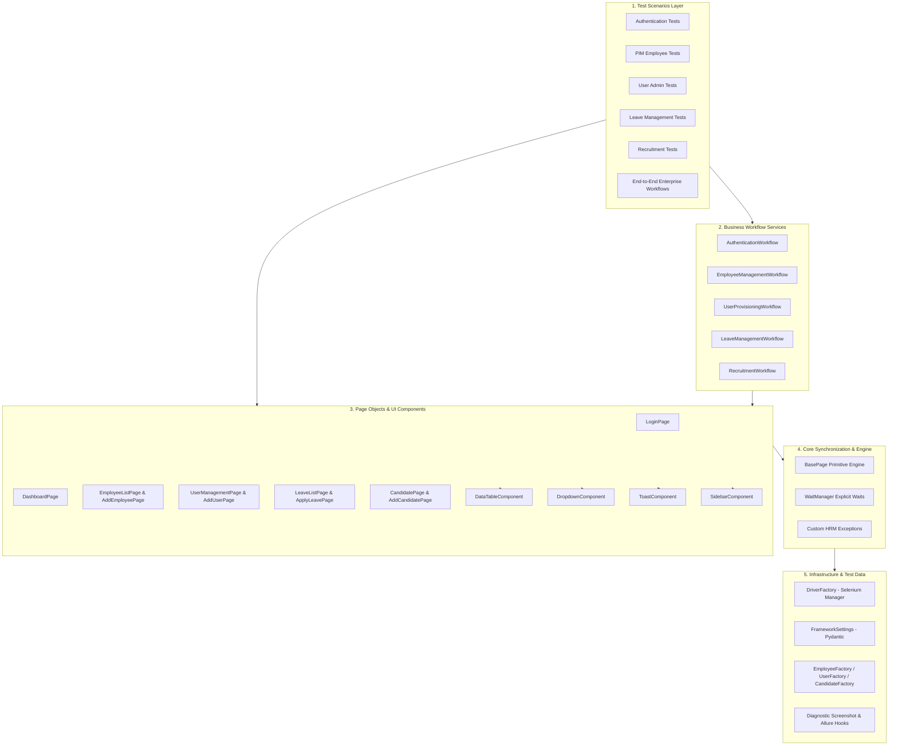
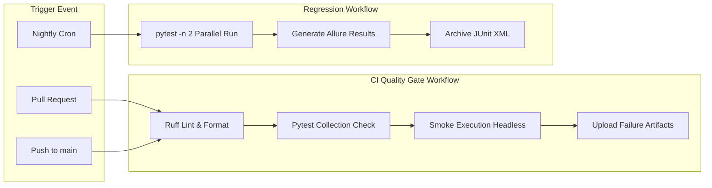

# Enterprise HRM Quality Engineering & Automation Platform

[](https://github.com/your-username/enterprise-hrm-automation/actions/workflows/ci.yml)
[](https://github.com/your-username/enterprise-hrm-automation/actions/workflows/regression.yml)
[](https://www.python.org/downloads/)
[](https://www.selenium.dev/)
[](https://docs.pytest.org/)
[](https://github.com/astral-sh/ruff)
[](LICENSE)

An enterprise-grade, observable test automation platform engineered in Python, Selenium WebDriver 4, and pytest. Designed to validate business-critical Human Resource Management workflows across authentication boundaries, employee lifecycles, user administration, leave requests, and recruitment pipelines.

Target Application: **OrangeHRM Open Source (Starter Edition v5.9)**  
Application URL: [https://opensource-demo.orangehrmlive.com](https://opensource-demo.orangehrmlive.com)

---

## 1. Executive Summary & Business Charter
Enterprise Human Resource platforms manage mission-critical corporate operations: identity provisioning, sensitive employee records, payroll linkages, statutory leave entitlements, and hiring pipelines. Automated testing in this domain must move beyond superficial UI checking to provide deterministic release confidence.

This repository demonstrates the engineering practices expected of a Senior / Principal SDET:
- **Decoupled 5-Layer Architecture**: Strict separation of concerns between test definitions, business workflow services, page objects, reusable UI components, and infrastructure.
- **Resilient Explicit Synchronization**: Zero reliance on arbitrary sleeps; centralized wait management handling Vue.js SPA state transitions, loading spinners, and stale-element recovery.
- **Collision-Resistant Test Data Engineering**: Dynamic test factories generating isolated records namespaced with pytest-xdist worker tokens and UUIDs to enable multi-threaded execution against shared environments without collisions.
- **Production CI/CD Pipelines**: Automated PR quality gates, multi-worker parallel regression, and cron health monitoring with automatic failure screenshot capture, JUnit XML, and Allure reporting.

---

## 2. Architecture & Design

### 2.1 Layered Architectural Diagram



### 2.2 Architectural Highlights
- **BasePage Design**: Encapsulates common browser interactions (`click`, `type_text`, `get_text`, `scroll_into_view`) with automatic stale-element retry loops (3 attempts with 0.3s backoff) and fallback to direct ActionChains/JS clicks when overlays intercept standard events.
- **Component Objects**: OrangeHRM's custom non-native dropdowns (`.oxd-select-wrapper`), tables (`.oxd-table`), and toast alerts (`.oxd-toast`) are abstracted into reusable Component classes rather than duplicated across page objects.
- **Selenium Manager Integration**: Eliminates third-party binary managers (`webdriver-manager`) by utilizing Selenium 4's native Rust-based driver resolution.
- **Anti-Flakiness Strategy**: Strictly bans `time.sleep()`. All waits use `WebDriverWait` with explicit conditions and spinner detection (`wait_for_spinner_to_disappear()`).

---

## 3. Technology Stack & Justification

| Technology | Role | Justification |
|---|---|---|
| **Python 3.12** | Core Language | Type-safe, readable, rich enterprise ecosystem for test automation. |
| **Selenium WebDriver 4.20+** | Browser Automation | Industry standard W3C compliant browser engine; native Chrome control via built-in Selenium Manager. |
| **pytest 8+** | Test Framework | Advanced fixture dependency injection, scoped lifecycle hooks, and parameterized test cases. |
| **pytest-xdist** | Concurrency Engine | Parallel test execution across multiple worker processes (`-n 2`, `-n 4`). |
| **Pydantic & Pydantic-Settings** | Configuration & Models | Type-safe environment variable parsing (`.env`, YAML) and immutable test data schemas. |
| **Faker** | Synthetic Data Generation | Realistic names, emails, dates, and identifiers preventing collision in parallel test runs. |
| **Allure & JUnit XML** | Reporting & Observability | Visual execution timelines, categorized failure diagnostics, and CI-native reporting. |
| **Ruff & mypy** | Code Quality | Blazing fast linting, formatting (PEP 8), and static type checking. |

---

## 4. Repository Structure

```text
enterprise-hrm-automation/
├── .github/
│   └── workflows/
│       ├── ci.yml                 # Pull request gate: Ruff lint + test collection + smoke tests
│       ├── regression.yml         # Full regression dispatch with parallel execution & Allure
│       └── scheduled-smoke.yml    # Daily cron health verification against production target
│
├── config/
│   ├── environments/
│   │   ├── demo.yaml              # Public hosted demo configuration
│   │   ├── local.yaml             # Docker / local self-hosted instance configuration
│   │   └── staging.yaml           # Enterprise staging profile
│   └── settings.py                # Pydantic centralized configuration engine
│
├── src/
│   └── hrm_automation/
│       ├── core/
│       │   ├── base_page.py       # Foundational page primitive engine with retry logic
│       │   ├── driver_factory.py  # W3C driver instantiation via Selenium Manager
│       │   ├── wait_manager.py    # Explicit synchronization & custom expected conditions
│       │   └── exceptions.py      # Context-rich domain exceptions
│       │
│       ├── components/
│       │   ├── data_table.py      # .oxd-table grid handler
│       │   ├── dropdown.py        # .oxd-select custom dropdown handler
│       │   ├── modal.py           # .oxd-dialog confirmation sheet handler
│       │   ├── sidebar.py         # .oxd-sidepanel responsive navigation menu
│       │   └── toast.py           # .oxd-toast notification capture
│       │
│       ├── pages/
│       │   ├── auth/              # LoginPage
│       │   ├── dashboard/         # DashboardPage
│       │   ├── admin/             # UserManagementPage & AddUserPage
│       │   ├── pim/               # EmployeeListPage, AddEmployeePage, PersonalDetailsPage
│       │   ├── leave/             # LeaveListPage & ApplyLeavePage
│       │   ├── recruitment/       # CandidatePage & AddCandidatePage
│       │   └── directory/         # DirectoryPage
│       │
│       ├── workflows/
│       │   ├── authentication.py     # Login, session verification, logout service
│       │   ├── employee_management.py# PIM creation, search, and update service
│       │   ├── user_provisioning.py  # System user account linkage service
│       │   ├── leave_management.py   # Leave application and review service
│       │   └── recruitment.py        # Candidate pipeline service
│       │
│       ├── data/
│       │   ├── models/            # Pydantic models (Employee, User, Candidate, Leave)
│       │   └── factories/         # Dynamic Faker data factories with worker isolation
│       │
│       └── utilities/
│           ├── logging.py         # Thread-safe worker-aware structured logger
│           └── screenshots.py     # Automatic failure screenshot capturer & Allure attacher
│
├── tests/
│   ├── conftest.py                # Driver lifecycle, failure screenshot hooks, fixtures
│   ├── smoke/                     # Infrastructure & browser health tests
│   ├── authentication/            # AUTH-001 through AUTH-010 (Positive, negative, boundary)
│   ├── pim/                       # PIM-001 through PIM-011 (CRUD, validations, search)
│   ├── admin/                     # ADM-001 through ADM-009 (User provisioning, filtering)
│   ├── leave/                     # LEAVE-001 through LEAVE-008 (Leave views, validations)
│   ├── recruitment/               # REC-001 through REC-009 (Candidate creation, search)
│   ├── self_service/              # ESS-001 to ESS-002 (My Info, Directory access)
│   └── workflows/                 # E2E-001 to E2E-003 (Multi-module business journeys)
│
├── docs/
│   ├── architecture.md            # Detailed system design and component responsibilities
│   ├── test-strategy.md           # Risk-based testing matrix and coverage targets
│   ├── application-discovery.md   # Live reconnaissance data from OrangeHRM OS 5.9
│   ├── workflow-inventory.md      # Documented enterprise business processes
│   ├── test-data-strategy.md      # Namespacing, collision protection, and factories
│   ├── environment-setup.md       # Installation guide across operating systems
│   ├── execution-guide.md         # Comprehensive pytest CLI execution manual
│   ├── flaky-test-register.md     # Triage log and corrective actions
│   ├── limitations.md             # Documented application and environment constraints
│   ├── troubleshooting.md         # Operational triage for failure modes
│   └── architecture-decision-records/ # ADR-001 to ADR-004
│
├── scripts/
│   ├── run_smoke.py               # Fast smoke test runner
│   ├── run_regression.py          # Parallel regression test runner
│   └── clean_test_artifacts.py    # Test artifacts cleaning script
│
├── pyproject.toml                 # Dependencies, Ruff linting, and pytest settings
├── pytest.ini                     # Pytest CLI flags, markers, and logging configuration
├── requirements.txt               # Pinned reproducible dependencies
└── README.md                      # Project documentation and engineering showcase
```

---

## 5. Automated Functional Scope & Test Inventory

### 5.1 Test Inventory Matrix (41 Automated Scenarios)

| Module | Test ID | Description | Type | Priority |
|---|---|---|:---:|:---:|
| **Infra** | `INF-001` | Verify environment configuration loads from YAML and .env | Positive | Smoke |
| **Infra** | `INF-002` | Validate WebDriver lifecycle, DOM title, and element readiness | Positive | Smoke |
| **Infra** | `INF-003` | Validate diagnostic failure screenshot capture plumbing | Positive | Smoke |
| **Auth** | `AUTH-001` | Valid administrator login redirects to Dashboard | Positive | Smoke |
| **Auth** | `AUTH-002` | Invalid username displays 'Invalid credentials' alert banner | Negative | High |
| **Auth** | `AUTH-003` | Invalid password displays 'Invalid credentials' alert banner | Negative | High |
| **Auth** | `AUTH-004` | Missing username triggers inline 'Required' validation | Negative | Medium |
| **Auth** | `AUTH-005` | Missing password triggers inline 'Required' validation | Negative | Medium |
| **Auth** | `AUTH-006` | Both credentials empty triggers dual 'Required' validation | Negative | Medium |
| **Auth** | `AUTH-007` | Logout terminates user session and redirects to login | Positive | Smoke |
| **Auth** | `AUTH-008` | Direct access to protected page without auth redirects to login | Authorization | High |
| **Auth** | `AUTH-009` | Browser back button navigation does not restore revoked session | Authorization | High |
| **Auth** | `AUTH-010` | Session persistence across sidebar module navigation | Positive | Smoke |
| **Admin** | `ADM-001` | Open user management and verify table structure and headers | Positive | Smoke |
| **Admin** | `ADM-002` | Filter users table by existing 'Admin' username | Positive | Medium |
| **Admin** | `ADM-003` | Filter users table by User Role ('Admin' / 'ESS') | Positive | Medium |
| **Admin** | `ADM-004` | Filter users table by Account Status ('Enabled' / 'Disabled') | Positive | Medium |
| **Admin** | `ADM-007` | Missing required username triggers 'Required' validation | Negative | Medium |
| **Admin** | `ADM-009` | Missing employee linkage triggers 'Required' validation | Negative | Medium |
| **PIM** | `PIM-001` | Open employee list and verify table column headers | Positive | Medium |
| **PIM** | `PIM-002` | Create employee with dynamic synthetic data | Positive | Smoke |
| **PIM** | `PIM-003` | Search employee list by employee first name | Positive | High |
| **PIM** | `PIM-004` | Search employee list by exact Employee ID | Positive | High |
| **PIM** | `PIM-005` | Modify employee nickname and verify persistence after refresh | Positive | High |
| **PIM** | `PIM-007` | Missing first name triggers inline 'Required' validation | Negative | Medium |
| **PIM** | `PIM-008` | Missing last name triggers inline 'Required' validation | Negative | Medium |
| **PIM** | `PIM-010` | Searching non-existent employee displays 'No Records Found' | Negative | Low |
| **PIM** | `PIM-011` | Clicking cancel returns to employee list without creating record | Positive | Low |
| **Leave** | `LEAVE-001` | Open Leave module and verify table structure and date columns | Positive | Smoke |
| **Leave** | `LEAVE-002` | Navigate from Leave List to Apply Leave form | Positive | Medium |
| **Leave** | `LEAVE-008` | Submitting empty leave form triggers 'Required' validation | Negative | Medium |
| **Recruitment** | `REC-001` | Open Recruitment module and verify candidates table structure | Positive | Smoke |
| **Recruitment** | `REC-003` | Create job candidate with unique email and contact info | Positive | Smoke |
| **Recruitment** | `REC-004` | Search candidates table by candidate name | Positive | High |
| **Recruitment** | `REC-008` | Missing candidate name triggers inline 'Required' validation | Negative | Medium |
| **Recruitment** | `REC-009` | Invalid email format triggers 'Expected format' validation | Negative | Medium |
| **Self-Service** | `ESS-001` | Access My Info view and verify personal details populate | Positive | Medium |
| **Self-Service** | `ESS-002` | Access Directory and verify employee profile cards render | Positive | Medium |
| **Workflows** | `E2E-001` | Multi-module Employee Onboarding (PIM -> Search -> Directory) | Workflow | Smoke |
| **Workflows** | `E2E-002` | Multi-module Candidate Pipeline (Recruitment creation -> Search) | Workflow | High |
| **Workflows** | `E2E-003` | Multi-module Leave Lifecycle (Leave list -> Apply form validation)| Workflow | High |

---

## 6. Local Setup & Quickstart

### Prerequisites
- Python 3.10+ (Python 3.12 recommended)
- Google Chrome Stable
- `uv` (recommended) or standard `pip`

```bash
# 1. Clone repository
git clone https://github.com/your-username/enterprise-hrm-automation.git
cd enterprise-hrm-automation

# 2. Setup virtual environment & dependencies
uv venv .venv --python 3.12
source .venv/bin/activate
uv pip install -r requirements.txt

# 3. Configure environment variables
cp .env.example .env

# 4. Run Smoke Suite
pytest -m smoke -v
```

---

## 7. Execution Profiles & CLI Manual

```bash
# Run business-critical smoke tests (12 tests)
pytest -m smoke -v

# Run full regression suite
pytest -v

# Run parallel regression across 2 worker processes
pytest -n 2 -v

# Run specific domain test suites
pytest -m authentication -v
pytest -m pim -v
pytest -m admin -v
pytest -m leave -v
pytest -m recruitment -v

# Run all negative validation tests
pytest -m negative -v

# Run multi-module end-to-end workflows
pytest -m workflow -v

# Generate Allure visual report
allure serve reports/allure-results
```

---

## 8. CI/CD Architecture (GitHub Actions)



### GitHub Actions Workflows
1. **Pull Request & CI Quality Gate** (`.github/workflows/ci.yml`): Runs Ruff linting, verifies pytest collection, and executes headless smoke suite against the target environment.
2. **Full Regression Suite** (`.github/workflows/regression.yml`): Dispatched manually or nightly; runs multi-worker parallel execution and uploads Allure and JUnit artifacts.
3. **Daily Scheduled Health Gate** (`.github/workflows/scheduled-smoke.yml`): Scheduled daily cron executing conservative smoke validation with failure alert retention.

---

## 9. Failure Observability & Diagnostics
When a test fails, the framework automatically captures and aggregates diagnostic evidence:
- **Automatic Failure Screenshot**: Captured at the exact point of failure and saved to `artifacts/screenshots/FAILED_{test_name}_{timestamp}.png`.
- **Allure Attachment**: Embedded directly into the interactive Allure test report.
- **Thread-Safe Logging**: Timestamped, worker-tagged execution log preserved in `logs/execution.log` (and `logs/worker_{id}.log`).
- **Contextual Exceptions**: Custom exceptions retain the original underlying Selenium stack trace, current URL, and targeted locator.

---

## 10. Engineering Decision Records (ADRs)
- [ADR-001: Primary Automation Stack Selection (Python 3.12 + Selenium 4 vs Playwright)](docs/architecture-decision-records/ADR-001-automation-stack.md)
- [ADR-002: Test Data Management, Namespacing, and Non-Destructive Policy](docs/architecture-decision-records/ADR-002-test-data-and-environment-strategy.md)
- [ADR-003: Decoupled 5-Layer Architecture](docs/architecture-decision-records/ADR-003-layered-architecture.md)
- [ADR-004: Explicit Synchronization & Anti-Flakiness Strategy](docs/architecture-decision-records/ADR-004-explicit-synchronization.md)

---

## 11. Known Limitations & Future Roadmap
- **Public Demo Rate Limiting**: The public hosted demo (`opensource-demo.orangehrmlive.com`) is a shared environment with occasional latency spikes. Destructive tests and concurrency >2 should be executed against local Docker containers.
- **Open Source Starter Scope**: Features restricted to OrangeHRM Enterprise (multi-tier hierarchical approvals, OAuth2 REST API, LDAP/SSO) are intentionally omitted from open-source scope.
- **Roadmap Improvements**:
  - Docker Compose recipe for completely offline, localized OrangeHRM test runs.
  - Visual regression baseline testing using Playwright accessibility snapshots.
  - CI pipeline integration with Slack/Microsoft Teams webhooks.

---

## 12. License
This project is licensed under the MIT License — see the [LICENSE](LICENSE) file for details.
