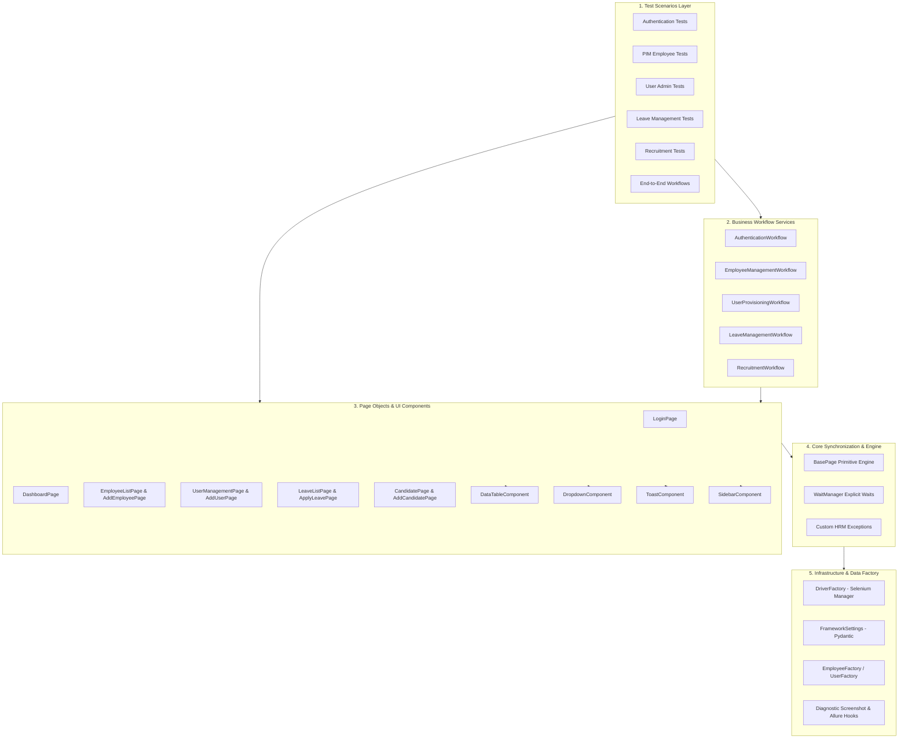

# Automation Platform Architecture & Engineering Design

## 1. Architectural Philosophy & Charter
The Enterprise Human Resource Management (HRM) Quality Engineering Platform is engineered as a decoupled, resilient, observable test automation platform. Rather than writing fragile browser scripts, the architecture provides a maintainable test harness designed to support continuous integration and cross-functional quality gates.

---

## 2. Decoupled Layer Architecture

### Layer 1: Test Suites (`tests/`)
- Contains test functions parameterized with fixtures and scoped with descriptive markers (`smoke`, `regression`, `negative`, `workflow`).
- Pure test logic: asserts expected business conditions, validates HTTP/DOM outcomes, and leaves interaction mechanics to lower layers.
- Direct WebDriver calls are prohibited in test functions.

### Layer 2: Business Workflows (`src/hrm_automation/workflows/`)
- Expresses end-to-end business intent (e.g., `create_employee_and_verify()`, `provision_user()`, `login_as_admin()`).
- Coordinates transitions across multiple Page Objects, handling data extraction, state validation, and multi-step verification.

### Layer 3: Page Objects & Reusable Components (`src/hrm_automation/pages/` & `components/`)
- Encapsulates view-specific locators and atomic UI interactions.
- Reusable UI widgets that appear repeatedly across modules (custom Vue dropdowns `.oxd-select-wrapper`, tables `.oxd-table`, toast alerts `.oxd-toast`, sidebar `.oxd-sidepanel`) are abstracted into independent Component classes.

### Layer 4: Core Engine (`src/hrm_automation/core/`)
- **BasePage**: Encapsulates resilient interaction primitives (`click()`, `type_text()`, `get_text()`, `scroll_into_view()`) with automatic stale-element recovery and fallback handlers.
- **WaitManager**: Enforces explicit synchronization using `WebDriverWait` and custom expected conditions (`wait_for_spinner_to_disappear()`, `wait_for_clickable()`).
- **Exceptions**: Custom domain exceptions (`ElementNotFoundException`, `TimeoutException`, `WorkflowExecutionException`) preserving underlying diagnostic tracebacks.

### Layer 5: Infrastructure & Test Data (`src/hrm_automation/core/driver_factory.py`, `data/`)
- **DriverFactory**: Implements W3C compliant browser configuration, headless execution, security sandbox flags, and Selenium Manager automated driver binary resolution.
- **Data Factories**: `EmployeeFactory`, `UserFactory`, and `CandidateFactory` generate synthetic, collision-resistant records namespaced with pytest worker IDs and unique UUID segments.
